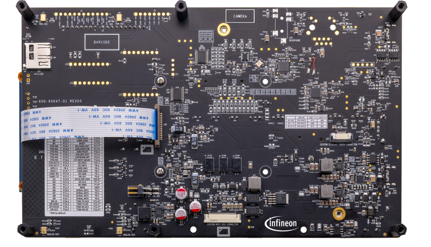
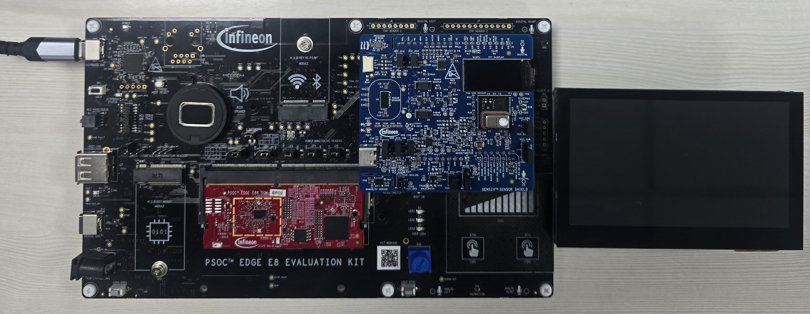
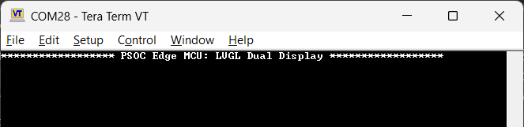
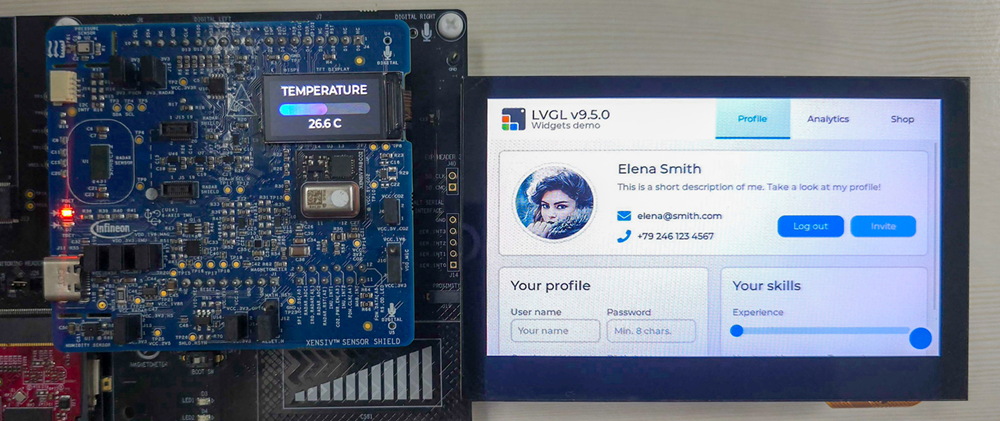

# PSOC&trade; Edge MCU: LVGL dual display

This code example demonstrates how to drive **two displays simultaneously** on a PSOC&trade; Edge MCU, each rendering an independent Light and Versatile Graphics Library (LVGL) user interface. It shows how to combine a MIPI-DSI display path with a simple serial display path in a single FreeRTOS application:

- **4.3-inch MIPI-DSI display (Waveshare):** Runs the LVGL Widgets demo (multi-tab UI with profile, controls, charts, and a date picker), GPU-accelerated through the VG-Lite 2.5D GPU and the PSOC&trade; Edge graphics subsystem (GFXSS)
- **ST7735S 0.96-inch SPI TFT display (on the SHIELD_XENSIV_A):** Runs a live thermometer UI, a blue-to-red gradient temperature bar plus a numeric &deg;C readout, sourced from the on-shield XENSIV&trade; DPS368 sensor over I2C and refreshed periodically

This code example has a three-project structure: CM33 secure, CM33 non-secure, and CM55 projects. All three projects are programmed to the external QSPI flash and executed in Execute-in-Place (XIP) mode. Extended boot launches the CM33 secure project from a fixed location in the external flash, which then configures the protection settings and launches the CM33 non-secure application. Additionally, the CM33 non-secure application enables the CM55 CPU and launches the CM55 application. The CM55 application implements the dual-display logic for this code example.

See the [Design and implementation](docs/design_and_implementation.md) for the functional description of this code example.

## Requirements

- [ModusToolbox&trade;](https://www.infineon.com/modustoolbox) v3.9 or later (tested with v3.9)
- Board support package (BSP) minimum required version: 1.4.0
- Programming language: C
- Associated parts: All [PSOC&trade; Edge MCU](https://www.infineon.com/products/microcontroller/32-bit-psoc-arm-cortex/32-bit-psoc-edge-arm) parts

## Supported toolchains (make variable 'TOOLCHAIN')

- GNU Arm&reg; Embedded Compiler v14.2.1 (`GCC_ARM`) – Default value of `TOOLCHAIN`
- Arm&reg; Compiler v6.22 (`ARM`)
- IAR C/C++ Compiler v9.70.4 (`IAR`)
- Arm&reg; Toolchain for Embedded v22.1 (`LLVM_ARM`)

## Supported kits (make variable 'TARGET')

- [PSOC&trade; Edge E84 Evaluation Kit](https://www.infineon.com/KIT_PSE84_EVAL) (`KIT_PSE84_EVAL_EPC2`) – Default value of `TARGET`
- [PSOC&trade; Edge E84 Evaluation Kit](https://www.infineon.com/KIT_PSE84_EVAL) (`KIT_PSE84_EVAL_EPC4`)

> **Note:** The second (ST7735S SPI) display is mounted on the [SHIELD_XENSIV_A](https://www.infineon.com/evaluation-board/SHIELD-XENSIV-A) through the Arduino headers. The pin mapping used by this example (see [Hardware setup](#hardware-setup)) has been verified on the PSOC&trade; Edge E84 Evaluation Kit.

## Hardware setup

This example uses the board's default configuration. See the kit user guide to ensure that the board is configured correctly.

Ensure the following jumper and pin configuration on the board:
- BOOT SW must be in the HIGH/ON position
- J20 and J21 must be in the tristate/not connected (NC) position for the PSOC&trade; Edge E84 Evaluation Kit

### First display: Waveshare 4.3-inch Raspberry Pi DSI display

Connect the FPC 15-pin cable between the display connector and the PSOC&trade; Edge E84 Evaluation Kit's RPi MIPI DSI connector (**J39**) as shown in **Figure 1**.

   **Figure 1.  4.3-inch display connection with PSOC&trade; Edge E84 Evaluation Kit**

   

### Second display: ST7735S 0.96-inch SPI TFT on the SHIELD_XENSIV_A

Mount the [SHIELD_XENSIV_A](https://www.infineon.com/evaluation-board/SHIELD-XENSIV-A) on the PSOC&trade; Edge E84 Evaluation Kit through the Arduino headers as shown in **Figure 2**. The shield carries the ST7735S SPI TFT display and the XENSIV&trade; DPS368 pressure/temperature sensor used by this example. The signals used are listed in **Table 1**.

**Table 1. ST7735S display connections (SHIELD_XENSIV_A on PSOC&trade; Edge E84 Evaluation Kit)**

Display signal | Shield pin | EVAL kit pin | BSP alias (raw) | BSP alias (used by the example)
---------------|------------|--------------|-----------------|--------------------------------
SPI MOSI       | D11        | P16.1        | `CYBSP_SPI_MOSI`   | `CYBSP_SPI_CONTROLLER` (SCB10)
SPI CLK        | D13        | P16.0        | `CYBSP_SPI_CLK`    | `CYBSP_SPI_CONTROLLER` (SCB10)
SPI CS         | D10        | P16.3        | `CYBSP_SPI_CS`     | `CYBSP_SPI_CONTROLLER` (SCB10)
CS selection   | D9         | P10.7        | `CYBSP_ARD_D9`     | `CYBSP_DISP_CS_SEL`
Reset (RST)    | D2         | P13.6        | `CYBSP_ARD_D2`     | `CYBSP_SHIELD_DISP_RST`
Data/Command (DC) | A0      | P15.2        | `CYBSP_ARD_ADC_0`  | `CYBSP_DISP_DC`

The XENSIV&trade; DPS368 sensor and the 4.3-inch display's touch controller share the I2C controller (`CYBSP_I2C_CONTROLLER`, SCB0).

   **Figure 2. SHIELD_XENSIV_A connection with PSOC&trade; Edge E84 Evaluation Kit**

   

> **Note:** 
>- The BSP aliases in the above table are configured in the Device Configurator for this example. When creating a custom BSP, enable and assign the SPI (SCB10), the shared I2C (SCB0), and the three GPIOs (`CYBSP_DISP_CS_SEL`, `CYBSP_SHIELD_DISP_RST`, `CYBSP_DISP_DC`) so that the source builds unchanged.
> - On the SHIELD_XENSIV_A, remove the 2.2 kΩ resistor **R72** before running this example. R72 pulls `SPI_CS_SEL0` (Arduino D9) up to `VIO_REF`, holding the on-shield chip-select MUX (U21) on the RADAR path. On the PSOC&trade; Edge E84 Evaluation Kit, the voltage translator between the MCU and D9 cannot override this pull-up, so the firmware cannot switch U21 to the display path and the ST7735S display stays unresponsive.

## Software setup

See the [ModusToolbox&trade; tools package installation guide](https://www.infineon.com/ModusToolboxInstallguide) for information about installing and configuring the tools package.

Install a terminal emulator if you do not have one. Instructions in this document use [Tera Term](https://teratermproject.github.io/index-en.html).

This example requires no additional software or tools.

## Operation

See [Using the code example](docs/using_the_code_example.md) for instructions on creating a project, opening it in various supported IDEs, and performing tasks, such as building, programming, and debugging the application within the respective IDEs.

1. Connect the 4.3-inch DSI display to J39 and mount the SHIELD_XENSIV_A as described in [Hardware setup](#hardware-setup)

2. Connect the board to your PC using the provided USB cable through the KitProg3 USB connector

3. Open a terminal program and select the KitProg3 COM port. Set the serial port parameters to 8N1 and 115200 baud

4. Build and program the application

5. After programming, the application starts automatically. Confirm that "PSOC Edge MCU: LVGL Dual Display" is displayed on the UART terminal

   **Figure 3.  Terminal output on program startup**

   

6. Observe the two displays running concurrently as shown in **Figure 4**:

   - The 4.3-inch DSI display shows the LVGL Widgets demo. Use the touch screen to navigate the tabs and controls
   - The ST7735S SPI display shows a live thermometer bar and a numeric &deg;C value that tracks the on-shield DPS368 sensor. Warm the sensor (for example, by touching it) to see the bar and value rise

   **Figure 4. Output on Displays**

   

## Related resources

Resources  | Links
-----------|----------------------------------
Application notes  | [AN235935](https://www.infineon.com/AN235935) – Getting started with PSOC&trade; Edge E8 MCU on ModusToolbox&trade; software   [AN239191](https://www.infineon.com/AN239191) – Getting started with graphics on PSOC&trade; Edge MCU
Code examples  | [Using ModusToolbox&trade;](https://github.com/Infineon/Code-Examples-for-ModusToolbox-Software) on GitHub   [PSOC&trade; Edge MCU: Graphics LVGL demo](https://github.com/Infineon/mtb-example-psoc-edge-gfx-lvgl-demo)
Device documentation | [PSOC&trade; Edge MCU datasheets](https://www.infineon.com/products/microcontroller/32-bit-psoc-arm-cortex/32-bit-psoc-edge-arm#documents)   [PSOC&trade; Edge MCU reference manuals](https://www.infineon.com/products/microcontroller/32-bit-psoc-arm-cortex/32-bit-psoc-edge-arm#documents)
Development kits | Select your kits from the [Evaluation board finder](https://www.infineon.com/cms/en/design-support/finder-selection-tools/product-finder/evaluation-board)
Libraries  | [mtb-dsl-pse8xxgp](https://github.com/Infineon/mtb-dsl-pse8xxgp) – Device support library for PSE8XXGP   [retarget-io](https://github.com/Infineon/retarget-io) – Utility library to retarget STDIO messages to a UART port   [display-dsi-waveshare-4-3-lcd](https://github.com/Infineon/display-dsi-waveshare-4-3-lcd) – Display driver for Waveshare 4.3 inch DSI display   [touch-ctp-ft5406](https://github.com/Infineon/touch-ctp-ft5406) – Touch driver for FT5406 capacitive touch panel of Waveshare 4.3 inch DSI display   [display-tft-st7735s](https://github.com/Infineon/display-tft-st7735s) – Display driver for the ST7735S display   [sensor-xensiv-dps3xx](https://github.com/Infineon/sensor-xensiv-dps3xx) – Driver library for the XENSIV&trade; DPS368 sensor
Tools  | [ModusToolbox&trade;](https://www.infineon.com/modustoolbox) – ModusToolbox&trade; software is a collection of easy-to-use libraries and tools enabling rapid development with Infineon MCUs for applications ranging from wireless and cloud-connected systems, edge AI/ML, embedded sense and control, to wired USB connectivity using PSOC&trade; Industrial/IoT MCUs, AIROC&trade; Wi-Fi and Bluetooth&reg; connectivity devices, XMC&trade; Industrial MCUs, and EZ-USB&trade;/EZ-PD&trade; wired connectivity controllers. ModusToolbox&trade; incorporates a comprehensive set of BSPs, HAL, libraries, configuration tools, and provides support for industry-standard IDEs to fast-track your embedded application development

 

## Other resources

Infineon provides a wealth of data at [www.infineon.com](https://www.infineon.com) to help you select the right device, and quickly and effectively integrate it into your design.

## Document history

Document title: *CE243629* - *PSOC&trade; Edge MCU: LVGL dual display*

 Version | Description of change
 ------- | ---------------------
 1.0.0   | New code example
 

All referenced product or service names and trademarks are the property of their respective owners.

The Bluetooth&reg; word mark and logos are registered trademarks owned by Bluetooth SIG, Inc., and any use of such marks by Infineon is under license.

PSOC&trade;, formerly known as PSoC&trade;, is a trademark of Infineon Technologies. Any references to PSoC&trade; in this document or others shall be deemed to refer to PSOC&trade;.

---------------------------------------------------------

(c) 2026, Infineon Technologies AG, or an affiliate of Infineon Technologies AG. All rights reserved.
This software, associated documentation and materials ("Software") is owned by Infineon Technologies AG or one of its affiliates ("Infineon") and is protected by and subject to worldwide patent protection, worldwide copyright laws, and international treaty provisions. Therefore, you may use this Software only as provided in the license agreement accompanying the software package from which you obtained this Software. If no license agreement applies, then any use, reproduction, modification, translation, or compilation of this Software is prohibited without the express written permission of Infineon.
 
Disclaimer: UNLESS OTHERWISE EXPRESSLY AGREED WITH INFINEON, THIS SOFTWARE IS PROVIDED AS-IS, WITH NO WARRANTY OF ANY KIND, EXPRESS OR IMPLIED, INCLUDING, BUT NOT LIMITED TO, ALL WARRANTIES OF NON-INFRINGEMENT OF THIRD-PARTY RIGHTS AND IMPLIED WARRANTIES SUCH AS WARRANTIES OF FITNESS FOR A SPECIFIC USE/PURPOSE OR MERCHANTABILITY. Infineon reserves the right to make changes to the Software without notice. You are responsible for properly designing, programming, and testing the functionality and safety of your intended application of the Software, as well as complying with any legal requirements related to its use. Infineon does not guarantee that the Software will be free from intrusion, data theft or loss, or other breaches ("Security Breaches"), and Infineon shall have no liability arising out of any Security Breaches. Unless otherwise explicitly approved by Infineon, the Software may not be used in any application where a failure of the Product or any consequences of the use thereof can reasonably be expected to result in personal injury.
